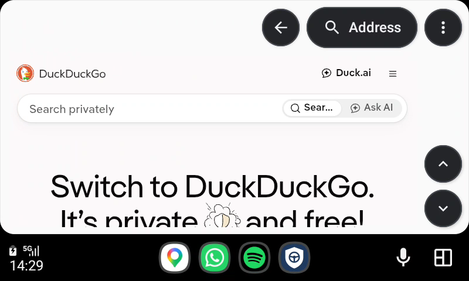
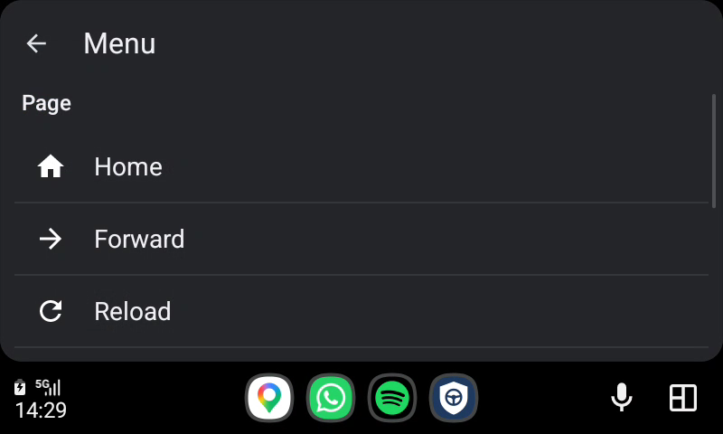

<p align="center"></p>

# Curbside


[](LICENSE)

> **Read the [DISCLAIMER](DISCLAIMER.md) before installing or using this app.**
> Do not interact with it while driving.

A lightweight web and video browser for **Android Auto**. It works on phones
running **Android 14 and older**, where Android Auto won't show normal
full-screen apps (such as PrivaCar or AABrowser).

<p align="center">
  
  
</p>

## Contents
- [Quick start](#quick-start)
- [Using it in the car](#using-it-in-the-car)
- [The phone app](#the-phone-app)
- [How it works](#how-it-works)
- [Troubleshooting](#troubleshooting)
- [Limitations](#limitations)
- [Build from source](#build-from-source)

## Quick start

**Requirements**
- An Android phone running Android 8 or newer (tested on a Galaxy A52s, Android 14).
- Android Auto, with **Unknown sources** turned on (step 2).
- A car or head unit with Android Auto (USB or wireless).

**Install**
1. Install the Curbside APK on the phone (open the file and allow installing from
   that source, or `adb install app-release.apk`). Play Protect may warn about a
   sideloaded app: choose *More details*, then *Install anyway*.
2. Turn on **Unknown sources** in Android Auto: open Android Auto's settings, tap
   **Version** 10 times to unlock developer mode, then **⋮** > **Developer
   settings** > turn on **Unknown sources**.
3. Connect the phone to the car. **Curbside** appears in Android Auto's launcher.

*(Optional)* check the APK is genuine. The signing certificate's SHA-256 must be
`84:48:54:43:AD:A8:BB:DA:AF:72:7F:43:AA:E2:49:D0:96:DF:1F:D4:D2:72:E2:44:26:5A:9C:DB:41:22:1E:78`
(`apksigner verify --print-certs app-release.apk`).

## Using it in the car

| Control | What it does |
|---|---|
| **←** | Go back a page. |
| **Address** | Type a web address or a search (DuckDuckGo), with the car keyboard or voice. |
| **⋮** | Menu: Home, Forward, Reload, switch desktop or mobile site, and your bookmarks. |
| **▲ / ▼** | Scroll the page up or down by about one screen. |
| Tap the page | Taps links, buttons and video controls. |
| Drag / fling / pinch | Scroll freely and zoom (where the car screen supports it). |
| Tap a text box | Opens the car keyboard. What you type goes into the box and Enter is pressed, so searches on sites such as YouTube work. |

The buttons hide after a few seconds; tap the screen to bring them back.

**Video and audio.** HTML5 video (for example YouTube in the browser) plays on
the car screen with sound through the car speakers. Fullscreen video is
supported. Audio focus is handled by the built-in WebView, so your music only
pauses when a page actually plays something.

**Desktop site.** Curbside asks for desktop sites by default, because car
screens are wide. Switch to the mobile site from the menu if a site looks wrong.

## The phone app

Open **Curbside** on the phone for:
- the setup steps above,
- the **bookmark editor** (up to 12, shown in the car menu; edits are saved when you leave),
- tips and troubleshooting.

It follows your phone's dark mode.

## How it works

Android Auto on Android 14 and older only shows media apps, messaging apps and
**Car App Library** apps built from Google's templates. Navigation apps are the
only template apps that get a raw drawing surface for their map.

Curbside declares itself as a navigation app and draws a web page on that surface
instead of a map:

```
Car screen <- Android Auto <- NavigationTemplate (Curbside)
                                  |  SurfaceCallback.onSurfaceAvailable(surface)
                                  v
                    VirtualDisplay bound directly to the car surface
                                  |
                    Presentation (a window on that display)
                                  |
                               WebView  <- taps / scroll / fling / zoom from the car
```

- One WebView lives for the whole session, so pages and scroll positions survive
  switching apps.
- When the car shows another app, the WebView is paused and uses no CPU.
- Car taps are turned into touch events on the WebView. Text boxes on a page are
  detected with a small script and handed to the car's own keyboard, because the
  phone keyboard can't reach a virtual display.

| File | Role |
|---|---|
| `CurbsideCarAppService.kt` | Car entry point and session. |
| `BrowserScreen.kt` | The navigation template, buttons and surface callbacks. |
| `SurfaceRenderer.kt` | VirtualDisplay, Presentation, WebView, input, media session. |
| `AddressScreen.kt` | Car keyboard and voice input (address bar and page text boxes). |
| `MenuScreen.kt` | Page actions and bookmarks list. |
| `Urls.kt` | Address parsing, desktop user agent, bookmarks storage. |
| `SetupActivity.kt` | The phone app. |

## Troubleshooting

**Curbside isn't in the Android Auto launcher.**
1. Android Auto settings > **Customise launcher**: make sure Curbside is ticked.
2. Android Auto settings > **Developer settings**: make sure **Unknown sources**
   is still on.
3. Disconnect and reconnect the phone.

**Tapping play does nothing.** Update to the latest build. Older builds requested
audio focus twice and paused video right after it started.

**A site looks cramped or tiny.** Use **⋮** > *Switch to mobile site*, or pinch to zoom.

## Limitations

- **Sideload only.** Google Play only accepts navigation templates from real
  navigation apps.
- **No DRM video** (Netflix, Disney+ and similar): protected video can't be shown
  on a virtual display. YouTube in the browser works.
- **Android Auto may restrict the keyboard while driving**, depending on the car.
- Steering-wheel play/pause is wired to a media session but not yet confirmed
  on a real car.
- No tabs, downloads or extensions, by design: it is meant to stay small.

## Build from source

Requirements: JDK 17+, Android SDK with platform 37 and build tools 36.0.0.

```sh
./gradlew :app:testDebugUnitTest :app:assembleRelease
```

The APK is written to `app/build/outputs/apk/release/app-release.apk`.

Release signing reads `keystore.properties` in the project root (git-ignored):

```properties
storeFile=/path/to/release.jks
storePassword=...
keyAlias=...
keyPassword=...
```

Without that file the release APK is unsigned.

**Testing without a car:** use Android Auto's Desktop Head Unit (DHU). In
Android Auto's developer settings, tap *Start head unit server*, then:

```sh
adb forward tcp:5277 tcp:5277
desktop-head-unit --adb=5277
```

## License

[MIT](LICENSE). Not affiliated with Google. See the [DISCLAIMER](DISCLAIMER.md).
